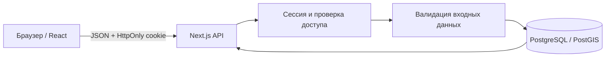

# Архитектура

Автор проекта: **ElpisHeart**. Текущая область: этапы 0 и 1.

## Компоненты

Next.js App Router обслуживает русскоязычный React-интерфейс и HTTP API в одном приложении. Клиентские компоненты отвечают за формы, выбор проекта и мира, отображение персонажей, отношений и хронологии. Серверный слой выполняет аутентификацию, проверку доступа, валидацию и SQL-операции. PostgreSQL хранит пользователей и весь лор; данные приложения не зависят от памяти браузера.

`src/lib/types.ts` содержит общие сериализуемые типы. `src/components/` и `src/app/` содержат интерфейс. `src/server/` содержит серверные операции; `src/app/api/` — транспорт HTTP. `db/migrations/` и `scripts/` содержат SQL-миграции и команды подготовки базы. Тесты разделены на unit, API/интеграционные и браузерные.

## Изоляция и сохранение

Иерархия данных: пользователь → приватный проект → мир → персонажи, события и отношения. Любая операция с дочерним объектом проверяет доступ к его проекту. Идентификатор объекта в URL не предоставляет разрешения на чтение или изменение. Связи событий и отношений допускают только персонажей того же мира.

Создание связанных данных и демонстрационной вселенной выполняется атомарно. Внешние ключи поддерживают целостность при удалении. Изменения регистрируются в аудите. Обновление сущностей использует номер версии; клиент с устаревшей версией получает HTTP 409. Клиент показывает ошибку и может загрузить актуальное состояние, вместо незаметной потери изменений.

Перезапуск приложения не должен удалять данные: PostgreSQL использует отдельный постоянный Docker volume. Постоянство тома не является резервной копией; восстановление требует внешней политики резервного копирования.

## Аутентификация

Пароли хешируются scrypt с индивидуальной солью. После входа сервер выдаёт непрозрачный случайный токен в HttpOnly-cookie. В базе хранится только его хеш и срок действия. Выход отзывает сессию. Cookie имеют `SameSite=Lax`; для HTTPS-развёртывания включается `SECURE_COOKIES=true`. Мутации дополнительно проверяют источник запроса.

Секреты доступны только серверу. Приложение не загружает удалённые шрифты и не требует внешнего ИИ API. Пользовательский текст отображается как текст, а не исполняемый HTML.

## Время и редакции

Первый этап хранит целые исторические годы от −1 000 000 000 до 1 000 000 000. События имеют начало и необязательный конец, персонажи — годы рождения и смерти, отношения — необязательные границы действия. Валидация не допускает окончание раньше начала.

Служебные timestamps регистрации и изменения записей используют обычное время сервера. Номер `version` защищает от конкурентной перезаписи, но не предоставляет историческую модель объекта. Просмотр события в хронологии не создаёт историческую версию биографии или отношений.

## Дальнейшее развитие

Следующие решения обозначают направление этапа 2 и ещё не реализованы:

- Разделить стабильную идентичность объекта и неизменяемые редакции его свойств.
- Ввести собственное представление времени и календари, сохранив возможность миграции текущих целых лет.
- Привязать состояния к временным линиям; при ответвлении фиксировать дату и конкретную редакцию родителя.
- Переиспользовать неизменяемые данные и хранить отличия ветки. Не изменять общие записи родительской линии и не оставлять ветку зависимой от её будущих изменений.
- Использовать общие идентификаторы персонажей для отношений, семейных древ, событий и Wiki.
- Для карт разделять семантические объекты, геометрию и исторические редакции. PostGIS подготовлен как зависимость инфраструктуры; редактор карт не входит в этот выпуск.
- Добавить провайдерский интерфейс ИИ отдельно от основного домена. Без подключённого провайдера приложение должно сохранять основную функциональность.

Эти расширения требуют миграций, тестов независимости веток и отдельного подтверждения пользователя перед началом реализации.
