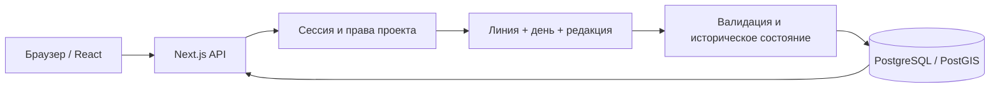

# Архитектура

Автор проекта: **ElpisHeart**. Текущая область — этап 4, энциклопедия версии 0.6.0 поверх работающих карт, исторической системы и дополнений прежних выпусков. Переносимые архивы, ИИ и публичная публикация остаются последующими этапами.

## Компоненты

Next.js App Router обслуживает React-интерфейс и TypeScript API одного origin. Клиент отвечает за формы, выбор проекта, мира, линии и даты. Сервер выполняет аутентификацию, проверку прав, валидацию, разрешение исторического состояния и транзакционные операции. PostgreSQL — источник постоянных данных; localStorage хранит только предпочтения интерфейса.

`src/lib/types.ts`, `history-types.ts`, `workspace-types.ts`, `map-types.ts` и `wiki-types.ts` задают JSON-контракт. `calendar.ts` выполняет чистые вычисления дат, `family.ts` — вывод семейных связей и проверки графа, `wiki-document.ts` проверяет безопасное дерево статьи и извлекает текст, ссылки и оглавление. `src/components/` содержит интерфейс, `src/server/` — операции с данными, `src/app/api/` — HTTP-транспорт. Схема развивается добавлением SQL-файлов в `db/migrations/`. Unit-, интеграционные и браузерные тесты проверяют разные уровни.

## Идентичность и неизменяемые редакции

Персонаж, событие и отношение имеют стабильный UUID в пределах мира. `lore_objects` хранит эту идентичность и счётчик конкурентных версий; `lore_revisions` содержит неизменяемые payload или отметку удаления. Ссылки между объектами используют UUID, а не копии карточек.

Редакция привязана к линии и целому дню начала действия. Глобальный номер `revision` задаёт порядок сохранения. Это две разные координаты: правка, внесённая сегодня, может начать действовать раньше в истории мира. Поле `version` защищает сохранение карточки от конкурентной перезаписи; оно не является датой или номером исторической эпохи.

Миграция этапа 2 переносит существующие данные первого выпуска в исходные редакции основной линии, сохраняя UUID и версии. Старые таблицы лора остаются архивом миграции; новые чтения и записи используют редакции. Аудит первого выпуска не трактуется как достоверная историческая шкала. Отсутствовавшие сведения о прошлом не выдумываются.

## Разрешение состояния линии

Линия содержит текущий `headRevision`. Ответвление дополнительно фиксирует `parentId`, **конкретный `parentRevision`** и **`forkDay`**. Оно ссылается на существующие неизменяемые данные; все записи мира не копируются.

При запросе состояния сервер выбирает подходящую собственную редакцию объекта: её день не позже запрошенного дня, а номер сохранения не выше выбранного среза редакций. Если своей редакции нет, поиск продолжается у родителя. При переходе к родителю ограничение редакции становится зафиксированным `parentRevision`, а дата — минимумом запрошенной даты и `forkDay`.

Оба ограничения обязательны:

- Поздняя правка родителя, в том числе внесённая задним числом, не меняет уже созданную ветку.
- Будущая относительно даты ответвления редакция не попадёт в ветку, даже если она уже существовала при ответвлении.
- Вложенное ответвление повторяет это правило по цепочке родителей. Модель не задаёт бизнес-ограничения на глубину.

Независимая линия не имеет родителя и начинается пустой. Дочернюю линию нельзя изменять раньше даты её ответвления. Каноничность линии — отдельный признак; она не переводит автоматически объекты из черновика в канон.

## Удаления, сравнение и перенос

Удаление карточки создаёт отметку удаления в выбранной линии и дате. Участие в событиях и групповых отношениях корректируется редакциями той же линии в одной транзакции: из группы удаляется соответствующий участник; если остаётся менее двух, связь получает отметку удаления. Ранние состояния и другие линии сохраняются. Удаление всего мира или проекта остаётся явным удалением соответствующих данных.

Сравнение сопоставляет одинаковые UUID в двух исторических состояниях и показывает добавленные, отсутствующие и изменённые данные. Служебный номер версии сам по себе не делает содержание различным.

Перенос выбранных объектов создаёт редакции в целевой линии, сохраняя UUID. Связанные персонажи включаются только при выбранном пользователем режиме. Отличающиеся существующие данные по умолчанию вызывают конфликт; замена требует явного подтверждения. Интерфейс передаёт редакции обеих сторон из сравнения; операция проверяет head цели и ожидаемый head источника, доступ, ссылки, семейные ограничения и применяется атомарно. Исходная линия не изменяется. Это перенос объектов, а не автоматическое слияние веток.

## Календари и даты

Каноническое время — целый порядковый день. В расчётах используется `BigInt`, в JSON — десятичная строка. День 0 — 1 января григорианского года 0; нумерация лет включает нулевой и отрицательные годы. Значения ±1 000 000 000 лет не требуют `JavaScript Date` или плавающей арифметики.

Определение календаря хранит месяцы и их длины, високосное правило, смещение эпохи и подпись эры. Преобразование в общий день и обратно позволяет показать одну дату в разных календарях. Сохранённые определения неизменяемы: изменение смысла даты требует нового календаря, а не правки старого правила.

Годы рождения/смерти, событий и интервалов отношений из первого выпуска сохраняют григорианский смысл. Выбор пользовательского календаря относится к историческому срезу и преобразованию даты, а не к переинтерпретации этих полей. Полная грамматика приблизительных дат, диапазонов, относительных выражений и нескольких эр пока не заявляется.

## Отношения с несколькими участниками

Одна историческая запись отношения описывает от 2 до 10 уникальных персонажей одного мира. `participantIds` задаёт весь состав. `fromId` и `toId` сохраняются для совместимости с прежними парами; старые неизменяемые payload читаются с нормализацией состава. Группа хранится одной записью и не создаёт декартово произведение пар. Проверка ссылок, перенос, история и удаление участника обрабатывают весь массив.

## Независимое семейное древо мира

По уточнению пользователя семейные связи 0.3.0 относятся к миру и доступны без выбора линии или дня. Для них используются общие стабильные UUID персонажей, собственные записи связей и версия общего состояния. Переключение линии не заменяет родство. Представители персонажей выбираются из живых последних состояний основной линии; при отсутствии там — из доступной другой линии с явным указанием её источника, а для сохранённого родства может использоваться последний известный архивный профиль.

Родитель направлен к ребёнку, допустимы биологическое и приёмное родительство и супруги. Братья и сёстры выводятся из общих родителей. Сервер проверяет происхождение, наличие персонажей того же мира, циклы и известную биологическую хронологию. Сохранение имеет контроль версий связей и общего семейного состояния.

Старые `familyKind`-отношения остаются неизменяемыми историческими фактами и читаются прежними API. При переходе их состояния разрешаются с учётом зафиксированных веток. Если семейные графы линий совпадают и непротиворечивы, общий граф можно инициализировать автоматически; при расхождениях пользователь с правом записи явно выбирает исходную линию и, при необходимости, дату. Старые факты сохраняются, общий граф впоследствии не синхронизируется автоматически с историческими familyKind-записями.

## Портреты и общий каталог

Портрет — отдельное вложение стабильного UUID персонажа, общее для его вариантов в линиях. Клиент отправляет исходный файл как ограниченное бинарное тело. Сервер разрешает PNG/JPEG/WebP, проверяет фактический декодированный формат и размер, ограничивает вход до 8192 пикселей по каждой стороне и 20 000 000 пикселей, уменьшает внутри 1200×1200 и перекодирует изображение в WebP, удаляя исходные метаданные. В PostgreSQL хранится обработанный файл; списки получают только URL с версией. Выдача изображения всегда проверяет сессию и доступ к миру, использует частные настройки кэша и nosniff.

Хранение `bytea` вместе с лором сохраняет портреты при переходе в новую папку ZIP и включает их в резервную копию БД. Платное внешнее хранилище не требуется. Удаление карточки из отдельной линии не уничтожает общий портрет другого доступного варианта.

Каталог «Все персонажи» выбирает только доступные пользователю проекты через серверные членства. Каждая строка представляет живое последнее состояние UUID в конкретной линии, разрешённое по её зафиксированным предкам. Подписи проекта, мира и линии объясняют контекст, а одинаковые имена не заменяют UUID. Поиск, фильтры и страницы применяются без раскрытия чужих приватных источников.

## Визуальный редактор временных линий

Полотно отображает структурные ответвления и отдельные ручные связи: пересечение историй, влияние и переход. Структурное происхождение, дата и редакция родителя остаются зафиксированными. Ручная связь служит явным описанием взаимодействия историй; перенос содержимого выполняется существующей командой сравнения и переноса с подтверждением конфликтов.

Позиции узлов, viewport, подписи и ручные связи сохраняются на уровне мира. Общая версия схемы защищает параллельные правки: устаревшее сохранение получает 409. Сервер проверяет принадлежность всех узлов миру, уникальность связей, конечность и границы координат, масштаб и права редактора. Цикл ручных сюжетных связей допустим; структурное древо родителей остаётся ацикличным.

## Географический редактор и историческая геометрия

OpenLayers работает на клиенте с локальной плоской проекцией. Размеры карты задают её extent; внешние земные тайлы и платные сервисы не нужны. Клиент отображает точки, линии, полигоны и мультиполигоны, но семантический тип хранится отдельно: например, государство — территориальный объект, а река — линейный. Физическое и политическое представления фильтруют слои одной карты, сохраняя общую основу.

Карты, слои и объекты имеют стабильные UUID в `lore_objects` с видами `maps`, `map_layers`, `map_features`. Их состояния записываются в общую `lore_revisions` и продвигают тот же `timelines.head_revision`. Геометрия каждой живой редакции объекта хранится как пространственное значение PostGIS с SRID 0 и как GeoJSON в payload. Пространственная проверка и триггер согласованности предотвращают расхождение представлений. Прежние исторические факты не переписываются.

Разрешение географии повторяет правила закреплённых предков: ограничиваются и редакция, и дата. Поэтому правка границы в дочерней линии не меняет родителя, а более поздняя правка родителя не проникает в уже существующую ветку. Изменение береговой линии, реки или города — новая редакция, не замена старой геометрии. Ссылку на событие можно сохранить в состоянии объекта. История редакций позволяет увидеть прежние геометрию, свойства, событие и отметки удаления.

Интерактивные правки сначала образуют локальный черновик. Полные снимки черновика обеспечивают отмену/повтор без записи фиктивных исторических фактов. Явное сохранение отправляет различия слоёв и объектов одной транзакцией с ожидаемой редакцией линии и версиями изменяемых объектов. При 409 пользователь сохраняет черновик и решает, когда перечитать актуальное состояние. Смена контекста и уход со страницы предупреждают о несохранённых изменениях.

Объединение и разделение территорий вычисляются PostGIS как предварительный результат. Они меняют черновик; постоянная история появляется после сохранения. Проверка данных включает геометрию, границы карты, семантический тип, ссылки на слой/родителя/событие и непротиворечивость будущих исторических точек. UUID карты или объекта не предоставляет права на чтение либо редактирование.

Выделенный объект рисуется с собственными заливкой, контуром, толщиной и порядком. Отдельная прозрачная пунктирная рамка обозначает выделение, не подменяя реальное оформление. Инспектор меняет визуальные свойства в черновике сразу; переключатели слоёв учитывают и сохранённую видимость, и физический/политический режим. Скрытые и заблокированные слои исключаются из взаимодействия. Исторические настройки атласа помещены в свёрнутую панель «Линия и время карты».

`src/lib/map-generator.ts` — чистый детерминированный генератор небольшой основы: остров, материки или архипелаг. Версия алгоритма, seed и preset определяют географию; размеры масштабируют координаты. Он не обращается к внешним сервисам. Серверный `src/server/map-generation.ts` сначала проверяет доступ, назначает свежие UUID с переназначением внутренних ссылок и сохраняет новую карту с пятью слоями и всеми объектами в одной транзакции через обычную валидацию и PostGIS. Никакой существующей карте не подменяется содержимое.

`map.generation` сохраняет seed, preset и algorithmVersion в JSONB-редакции карты без новой SQL-миграции. Последующие правки используют обычный черновик, версии и исторические редакции; генератор не запускается заново при чтении. Воспроизводимость относится к исходной основе, а не к изменённой вручную карте. Старые карты могут не иметь метаданных генерации и продолжают читаться как прежде.

Прежний resolver карточек фильтрует только персонажей, события и отношения. География читает свои виды редакций отдельно, сохраняя общую последовательность и снимки веток. Это не расширяет старое сравнение/перенос неявными географическими операциями.

## Энциклопедия и авторские статьи

`wiki-workspace.tsx` связывает список материалов, фильтры, чтение и черновик статьи с выбранными миром, линией и днём. Tiptap 3.32.0 отвечает за визуальное редактирование разрешённых узлов; отдельное React-представление читает проверенный JSON без вставки произвольного HTML. Заголовки образуют оглавление. Внутренние ссылки и встроенные карточки адресуют стабильный UUID, а не копию содержимого.

`src/server/wiki.ts` разрешает `wiki_articles` через общую последовательность `lore_revisions` и закреплённых предков. Каждая правка и логическое удаление создают редакцию; `version` защищает конкурентное сохранение. Чтение истории, поиска и автоматической карточки не создаёт записей. Автоматические страницы персонажей, событий, карт и географических объектов собираются из доступных структурированных состояний; необязательный `sourceId` связывает самостоятельную авторскую статью с такой карточкой. Изменение источника не переписывает документ автора.

Поиск выполняется PostgreSQL над уже разрешённым историческим состоянием. Это не даёт старой либо поздней родительской редакции попасть в результаты вместо закреплённой. Категории, теги и характер знания фильтруют доступные материалы. Метка `secret` («Тайна») не меняет проектные права. Обратные ссылки и связанные материалы вычисляются в том же контексте; отсутствующая цель не раскрывает её имя из чужого или недоступного состояния.

Общий валидатор документа ограничивает узлы, атрибуты, глубину, число узлов и объём текста. Ссылки допускают безопасные схемы, изображения — только локальные URL ресурсов Wiki. Сервер дополнительно проверяет UUID целей и принадлежность изображений миру. Неизменная архивная ссылка может остаться в статье после исчезновения её цели, тогда как новое назначение недоступного объекта отклоняется.

`src/server/wiki-images.ts` авторизует загрузку, декодирует PNG/JPEG/WebP до 5 МиБ с пределом 20 миллионов пикселей и 8192 пикселей по стороне, уменьшает внутри 2048×2048 и сохраняет статический WebP без исходных метаданных. `wiki_images` содержит неизменяемые байты ресурсов мира; их не удаляют при редактировании или историческом удалении статьи. Выдача файла вновь проверяет членство в проекте. Удаление всего мира удаляет ресурсы каскадно, обычный дамп PostgreSQL включает их.

Сохранение статьи явно записывает черновик в транзакции. Навигационный guard предупреждает о несохранённом тексте, 409 оставляет его для решения пользователем. Старое сравнение/перенос персонажей, событий и отношений не расширяется неявным переносом Wiki или карт.

## Доступ, сохранность и дальнейшее развитие

Каждая операция с объектами, семьёй, линиями, изображениями, каталогом, сравнением и календарями проверяет доступ через проект. Идентификатор в URL не предоставляет права. Новые проекты приватны, секреты доступны только серверу, пользовательский текст отображается как текст. Пароли хешируются scrypt; случайная сессия передаётся в HttpOnly-cookie, в БД хранится только её хеш. Мутации проверяют Origin.

Миграции и операции записи транзакционны. PostgreSQL использует постоянный Docker volume; он переживает перезапуск приложения и обновление ZIP, но не заменяет резервную копию. Не удаляйте volume ради обновления.

Стабильные UUID и отдельные редакции используются географическим этапом 3 и энциклопедией этапа 4. Пользователь подтвердил продолжение после проверки версии 0.5.0. Слияние линий, ИИ, переносимые архивы и публичная публикация требуют последующих этапов и проверок.
