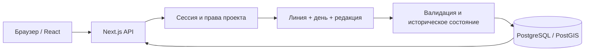

# Архитектура

Автор проекта: **ElpisHeart**. Текущая область — этапы 0–2; географический редактор и следующие подсистемы ещё не реализуются.

## Компоненты

Next.js App Router обслуживает React-интерфейс и TypeScript API одного origin. Клиент отвечает за формы, выбор проекта, мира, линии и даты. Сервер выполняет аутентификацию, проверку прав, валидацию, разрешение исторического состояния и транзакционные операции. PostgreSQL — источник постоянных данных; localStorage хранит только предпочтения интерфейса.

`src/lib/types.ts` и `history-types.ts` задают JSON-контракт. `calendar.ts` выполняет чистые вычисления дат, `family.ts` — вывод семейных связей и проверки графа. `src/components/` содержит интерфейс, `src/server/` — операции с данными, `src/app/api/` — HTTP-транспорт. Схема развивается добавлением SQL-файлов в `db/migrations/`. Unit-, интеграционные и браузерные тесты проверяют разные уровни.

## Идентичность и неизменяемые редакции

Персонаж, событие и отношение имеют стабильный UUID в пределах мира. `lore_objects` хранит эту идентичность и счётчик конкурентных версий; `lore_revisions` содержит неизменяемые payload или отметку удаления. Ссылки между объектами используют UUID, а не копии карточек.

Редакция привязана к линии и целому дню начала действия. Глобальный номер `revision` задаёт порядок сохранения. Это две разные координаты: правка, внесённая сегодня, может начать действовать раньше в истории мира. Поле `version` защищает сохранение карточки от конкурентной перезаписи; оно не является датой или номером исторической эпохи.

Миграция этапа 2 переносит существующие данные первого выпуска в исходные редакции основной линии, сохраняя UUID и версии. Старые таблицы лора остаются архивом миграции; новые чтения и записи используют редакции. Аудит первого выпуска не трактуется как достоверная историческая шкала. Отсутствовавшие сведения о прошлом не выдумываются.

## Разрешение состояния линии

Линия содержит текущий `headRevision`. Ответвление дополнительно фиксирует `parentId`, **конкретный `parentRevision`** и **`forkDay`**. Оно ссылается на существующие неизменяемые данные; все записи мира не копируются.

При запросе состояния сервер выбирает подходящую собственную редакцию объекта: её день не позже запрошенного дня, а номер сохранения не выше выбранного среза редакций. Если своей редакции нет, поиск продолжается у родителя. При переходе к родителю ограничение редакции становится зафиксированным `parentRevision`, а дата — минимумом запрошенной даты и `forkDay`.

Оба ограничения обязательны:

- Поздняя правка родителя, в том числе внесённая задним числом, не меняет уже созданную ветку.
- Будущая относительно даты ответвления редакция не попадёт в ветку, даже если она уже существовала при ответвлении.
- Вложенное ответвление повторяет это правило по цепочке родителей. Модель не задаёт бизнес-ограничения на глубину.

Независимая линия не имеет родителя и начинается пустой. Дочернюю линию нельзя изменять раньше даты её ответвления. Каноничность линии — отдельный признак; она не переводит автоматически объекты из черновика в канон.

## Удаления, сравнение и перенос

Удаление карточки создаёт отметку удаления в выбранной линии и дате. Связанные отношения и участие в событиях корректируются редакциями той же линии в одной транзакции. Ранние состояния и другие линии сохраняются. Удаление всего мира или проекта остаётся явным удалением соответствующих данных.

Сравнение сопоставляет одинаковые UUID в двух исторических состояниях и показывает добавленные, отсутствующие и изменённые данные. Служебный номер версии сам по себе не делает содержание различным.

Перенос выбранных объектов создаёт редакции в целевой линии, сохраняя UUID. Связанные персонажи включаются только при выбранном пользователем режиме. Отличающиеся существующие данные по умолчанию вызывают конфликт; замена требует явного подтверждения. Операция проверяет актуальный head целевой линии, доступ, ссылки, семейные ограничения и применяется атомарно. Исходная линия не изменяется. Это перенос объектов, а не автоматическое слияние веток.

## Календари и даты

Каноническое время — целый порядковый день. В расчётах используется `BigInt`, в JSON — десятичная строка. День 0 — 1 января григорианского года 0; нумерация лет включает нулевой и отрицательные годы. Значения ±1 000 000 000 лет не требуют `JavaScript Date` или плавающей арифметики.

Определение календаря хранит месяцы и их длины, високосное правило, смещение эпохи и подпись эры. Преобразование в общий день и обратно позволяет показать одну дату в разных календарях. Сохранённые определения неизменяемы: изменение смысла даты требует нового календаря, а не правки старого правила.

Годы рождения/смерти, событий и интервалов отношений из первого выпуска сохраняют григорианский смысл. Выбор пользовательского календаря относится к историческому срезу и преобразованию даты, а не к переинтерпретации этих полей. Полная грамматика приблизительных дат, диапазонов, относительных выражений и нескольких эр пока не заявляется.

## Семейные связи

Семейное древо строится из обычных отношений с `familyKind`: `parent`, `adoptive_parent` и `spouse`. Родитель направлен к ребёнку. Соседние узлы и супруги выводятся из этих связей, братья и сёстры — из общих родителей; производные отношения не дублируются в БД. Отсутствие известных родителей допустимо.

Проверка происхождения учитывает активные по дате связи. Сервер проверяет затрагиваемые исторические точки, чтобы задним числом внесённая правка не создала цикл в другой эпохе. Известное биологическое рождение ребёнка раньше родителя или после его смерти отклоняется. Усыновление не связывается искусственно с датой рождения ребёнка, но также не допускает циклического происхождения.

## Доступ, сохранность и дальнейшее развитие

Каждая операция с объектами, линиями, сравнением и календарями проверяет доступ через проект. Идентификатор в URL не предоставляет права. Новые проекты приватны, секреты доступны только серверу, пользовательский текст отображается как текст. Пароли хешируются scrypt; случайная сессия передаётся в HttpOnly-cookie, в БД хранится только её хеш. Мутации проверяют Origin.

Миграции и операции записи транзакционны. PostgreSQL использует постоянный Docker volume; он переживает перезапуск приложения и обновление ZIP, но не заменяет резервную копию. Не удаляйте volume ради обновления.

Стабильные UUID и отдельные редакции подготовлены для будущих карт, Wiki и исторической геометрии. PostGIS установлен как зависимость; географические объекты и OpenLayers относятся к этапу 3. Слияние линий, ИИ и публичная публикация требуют отдельных этапов и проверок. После этапа 2 необходимо подтверждение пользователя перед продолжением.
